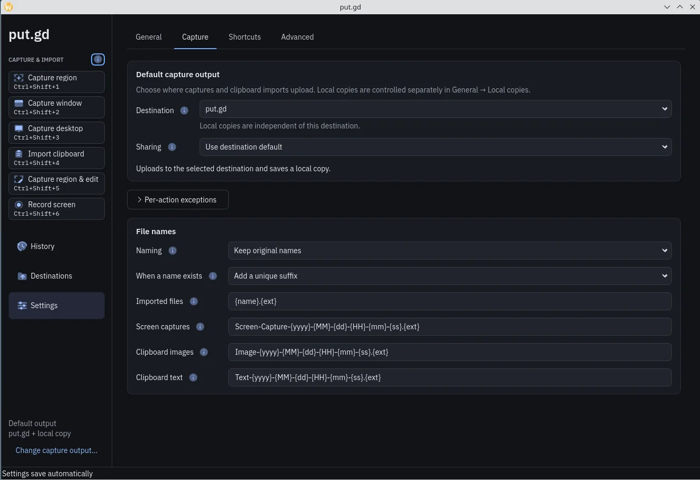

# Capture

This page shows you how to capture a region, a window or the whole desktop, how to upload your clipboard, and how to choose where the results go.

<picture class="shot">
  <source media="(prefers-color-scheme: light)" type="image/avif" sizes="(max-width: 760px) calc(100vw - 32px), 720px" srcset="/_site/shots/capture-light.avif 975w, /_site/shots/capture-light@2x.avif 1950w">
  <source type="image/avif" sizes="(max-width: 760px) calc(100vw - 32px), 720px" srcset="/_site/shots/capture-dark.avif 975w, /_site/shots/capture-dark@2x.avif 1950w">
  <source media="(prefers-color-scheme: light)" type="image/webp" sizes="(max-width: 760px) calc(100vw - 32px), 720px" srcset="/_site/shots/capture-light.webp 975w, /_site/shots/capture-light@2x.webp 1950w">
  
</picture>

Every action is on the left rail of the put.gd window and in the tray menu. The put.gd window closes during a screen capture to keep itself out of the picture. You can change any key in [shortcuts](settings.md#shortcuts).

## Capture region

1. Press ++ctrl+shift+1++, or choose **Capture region**.
2. Drag across the area you want, then let go. To cancel, press ++esc++.

### Capture an open menu

1. Go to **Settings → Capture → Region selection** and set **While selecting** to **Screenshot first**.
2. Open the menu you want, then press ++ctrl+shift+1++.
3. Close the menu if it is still open. The selector appears over a frozen picture of your screen.
4. Drag across the area you want.

## Capture window

1. Click the window you want.
2. Press ++ctrl+shift+2++, or choose **Capture window**.

Support varies by desktop. See [GNOME, KDE and Cinnamon](desktops.md).

## Capture desktop

Press ++ctrl+shift+3++, or choose **Capture desktop**. You get all your enabled monitors, panels included.

## Upload clipboard

1. Copy what you want to upload.
2. Choose **Upload clipboard**. It has no key until you set one.

put.gd looks for copied files first, then an image, then text. A copied web address uploads as text. The put.gd window stays open.

## After a capture

- **Link.** The link is copied to your clipboard. Uploads set to **Keep private** create no link and leave your clipboard alone.
- **Local copy.** The file is also saved on this computer if **Keep a local copy** is on.
- **History.** The capture appears in [History](history.md), which is also where you recover from a failed upload.

## Where captures go

{ .shot }

This picture comes from an older version. **Local copies** is now on this same page, and the exceptions section has a new name.

1. Go to **Settings → Capture**.
2. Under **Capture output**, choose a **Destination**. **No destination** turns uploads off. To add one, see [Set up a destination](destinations.md).
3. To send one action somewhere else, open **Different output for some actions**. **Use default** follows the main destination, and an action with its own choice keeps it when the main one changes. Your shortcuts stay as they are.
4. To keep files on this computer, turn on **Keep a local copy** under **Local copies**. They go to the **Save to** folder, which starts as `put.gd` inside your Documents folder.

| Destination | Keep a local copy | What happens |
| --- | --- | --- |
| Chosen | Off | Uploads the file |
| Chosen | On | Saves the file on this computer and uploads it |
| None | On | Saves the file on this computer only |
| None | Off | Shows an error and captures nothing |
