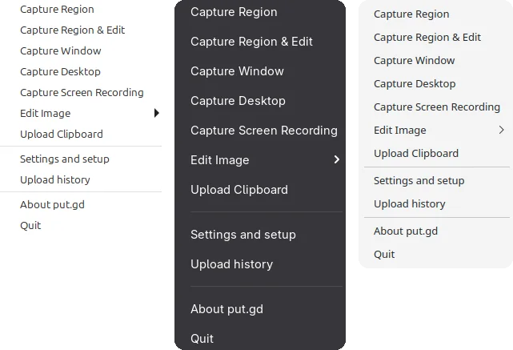

# Command line

`putgd-cli` lets your scripts do what the tray does. By the end of this page you will have started a capture from a terminal and read the reply.

{ .shot }

1. Start put.gd in your desktop session. The command talks to the running app and never starts it.
2. Check what your desktop supports:

    ```bash
    putgd-cli capabilities
    ```

3. Start a region capture:

    ```bash
    putgd-cli action.invoke '{"action":"region"}'
    ```

4. Copy the `operationId` from the reply and follow it:

    ```bash
    putgd-cli operation.inspect '{"id":"RETURNED-ID"}'
    ```

## Where it is

The DEB and RPM packages install it as `/usr/bin/putgd-cli`, so it is already on your path. In the AppImage it sits inside the image, so extract it first and run the copy:

```bash
./putgd-*.AppImage --appimage-extract
squashfs-root/usr/bin/putgd-cli capabilities
```

## Capture

`action` can be `region`, `window` or `desktop`.

```bash
putgd-cli action.invoke '{"action":"desktop"}'
```

## Upload the clipboard

Copied files are used first, then an image, then plain text.

```bash
putgd-cli action.invoke '{"action":"clipboard"}'
```

## Upload a file

No command uploads any file from a path. Copy the file in your file manager and upload the clipboard, as above.

A PNG or JPEG can go through the editor instead. Give its full path, then submit using the `operationId` from the reply:

```bash
putgd-cli action.invoke '{"action":"edit","source":"file","path":"/home/you/photo.png"}'
putgd-cli editor.submit '{"id":"RETURNED-ID"}'
```

## List recent work

```bash
putgd-cli operation.recent
```

To search what has been stored, use History's list:

```bash
putgd-cli history.list '{"limit":5,"category":"images"}'
```

## Copy a result

This never uploads again. Use the operation's ID:

```bash
putgd-cli operation.copy '{"id":"RETURNED-ID"}'
```

Or an item's ID from `history.list`:

```bash
putgd-cli history.copyLink '{"id":"HISTORY-ID"}'
```

## Read and change settings

```bash
putgd-cli settings.get
```

The settings are in `result.document`. To change one, pass `result.metadata.observedRevision` as `expectedRevision`:

```bash
putgd-cli settings.patch '{"patch":{"retention":{"recentActivityLimit":77}},"expectedRevision":"RETURNED-OBSERVED-REVISION"}'
```

Read the settings again afterwards. Enter access keys in [Destinations](destinations.md); the command line refuses them.

## Diagnostics

See the app's status, or save the package described in [Get help](troubleshooting.md#get-help):

```bash
putgd-cli diagnostics
putgd-cli diagnostics.bundle --since 7d
```

`diagnostics.bundle` also takes `--operation ID`, `--include-names` and `--output PATH`.

## Read the reply

Each command prints one JSON object. Logs go to stderr, so your script can parse stdout directly. A started capture looks like this, shortened:

```json
{
  "schemaVersion": 1,
  "requestId": "RETURNED-REQUEST-ID",
  "ok": true,
  "result": {
    "operationId": "RETURNED-ID",
    "operation": { "...": "..." }
  },
  "error": { "code": "", "message": "", "details": {} }
}
```

Check `ok`. When it is `false`, `error.code` and `error.message` say why. For example, `session_unavailable` means put.gd isn't running in this session.

!!! warning "Exit 0 doesn't mean the upload finished"
    It means the request was accepted. Follow the `operationId` with `operation.inspect` until you see the outcome. If a command times out, check `operation.recent` before trying again, because the first request may still finish.

## MCP for agents

An optional MCP server gives agents such as Claude Code and Claude Desktop the same actions as typed tools. It needs Python 3.12 or newer and `uv`, it never starts put.gd for you, and it comes from a checkout of the [desktop repository](https://github.com/patrick-hudson/put.gd-desktop). From the top of that checkout, set it up and start it with:

```bash
uv sync --project tools/mcp --locked
uv run --project tools/mcp --locked putgd-mcp --cli /usr/bin/putgd-cli
```
