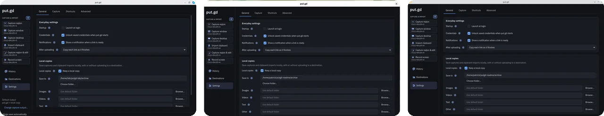
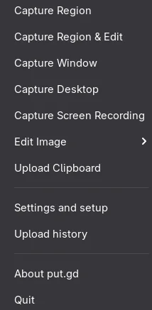
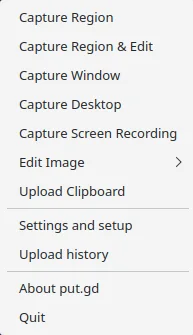
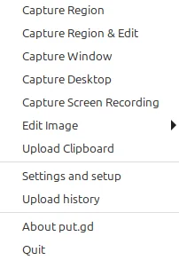

# GNOME, KDE and Cinnamon

put.gd works the same way on all three desktops, apart from the differences on this page. By the end, you know what to set up on yours and what to expect.

{ .shot }

put.gd supports GNOME 50 and KDE Plasma 6 on Wayland, and Cinnamon on X11. To see what your own desktop supports, open **Settings → Advanced**.

## GNOME

{ .shot }

GNOME needs put.gd's Shell extension, made for GNOME 50. It draws the region selector, takes the captures, handles the global shortcuts and the clipboard, and adds the text you see when you hover over the tray icon. Without it, put.gd can't capture your screen. The tray icon itself appears through GNOME's AppIndicator extension.

The packages include the extension: [log out and back in, then enable it](index.md). After a later update, log out and back in again. Until you do, screenshots keep working but recording a region is refused.

**With the AppImage**, install the extension yourself:

1. Open the [releases page](https://github.com/patrick-hudson/put.gd-desktop/releases) and find **Sources and GNOME integration** for your version.
2. Download the GNOME ZIP from it.
3. Install the ZIP, using its full path:

    ```bash
    gnome-extensions install /absolute/path/to/putgd-gnome50-VERSION.zip
    ```

4. Log out and back in.
5. Turn it on:

    ```bash
    gnome-extensions enable putgd@put.gd
    ```

When you record your only monitor, the recording bar has nowhere else to go. It shrinks to a dot and a Stop button in a corner, and appears in the video.

## KDE Plasma

{ .shot }

There is nothing extra to install on Plasma. Drag to select a region, and press ++esc++ or right-click to cancel.

Opening the region selector closes any open menu. To capture a menu, use **Capture desktop**, which includes it.

On Plasma 6.6 and later, the recording bar stays out of your recording. Debian 13's older Plasma doesn't hide it, so it can appear when you record a whole monitor.

## Cinnamon

{ .shot }

Cinnamon runs on X11, and there is nothing extra to install. The desktop keeps moving while you select a region: windows and video keep updating. Drag with the left button, and press ++esc++ or right-click to cancel.

## X11 and Wayland

Plasma can run on either, so these differences depend on your session as well as your desktop.

| | X11 | Wayland |
| --- | --- | --- |
| **Capture region** with a menu open | Starts once the menu closes. Press ++esc++ or click outside it within 3 seconds, or press the shortcut again. | GNOME opens the selector over the menu, so you can select it. Plasma closes the menu. |
| **Capture window** | Anything overlapping the window appears in the image. | On GNOME and Plasma, the window's own menus are left out. |
| **Record screen** | Drag the area to record. | Drag the area on GNOME and Plasma. Other Wayland desktops ask once which screen or window to share. |

## Shortcuts on every desktop

put.gd never takes a shortcut from another app. Open **Settings → Shortcuts** to see any conflict beside its row, then choose a different combination.
