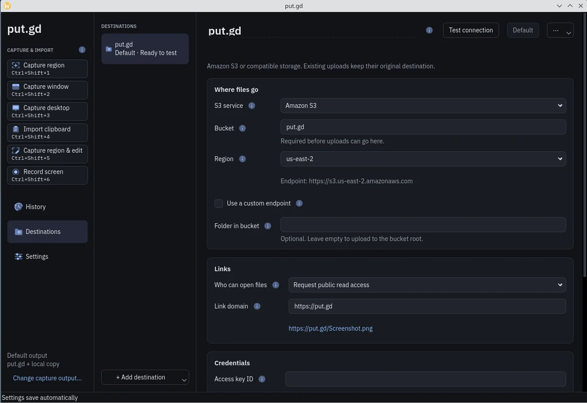

# Amazon S3 and compatible storage

Connect your own bucket so that put.gd uploads to it and gives you a link for each file. You need a bucket and an access key before you start.

{ .shot }

This picture is from an earlier version, so some labels differ.

1. In **Destinations**, click **Add destination** and choose **Amazon S3 / S3-compatible**.
2. Under **Where files go**, enter the **Bucket**.
3. Choose the **Region**. You can also type one that isn't listed.
4. Under **Links**, choose an **Upload access request**.
5. Enter a **Link domain** if you have one.
6. Under **Credentials**, enter your **Access key ID** and **Secret access key**. Fill in **Session token** only if your key came with one.
7. Choose **Credential storage**, then click **Save to keychain** or **Use for this session**.
8. Click **Test upload and link**.

## Links

**Upload access request** decides what each upload asks for:

- **Use bucket policy** (the default) sends no ACL. Your bucket's policy decides who can open files.
- **Request public read** asks S3 to make each new file public. The bucket must have ACLs turned on.

**Link domain** is the start of each link, such as `https://demo.put.gd`, with an example shown below the field. Left empty, links use the bucket's own address.

put.gd never changes your bucket's policy or your domain's settings.

## Credentials

- **System keychain** saves the key in your desktop's keychain for next time.
- **This session only** keeps it in memory until put.gd closes, then you enter it again.

Keys are never written to settings or history.

## What the test does

**Test upload and link** runs only when you click it, and it uses a small made-up text file. It shows its progress and result below the destination's name.

Success means the test file uploaded, opened through a public link, and was removed again. If a step fails, the message says what to check next.

## Minimum bucket permissions

- `s3:GetObject`
- `s3:PutObject`
- `s3:ListBucket`, recommended. Without it, a missing file looks the same as a refused one.
- `s3:PutObjectAcl`, only with **Request public read**.

The test and deleting from History also use `s3:DeleteObject` and `s3:GetBucketVersioning`. Large files also use `s3:AbortMultipartUpload` and `s3:ListMultipartUploadParts`. The test tells you which permissions S3 refused.

## S3-compatible services

Set **S3 service** to **Cloudflare R2** or **Other S3-compatible**, then open **Advanced connection settings**:

- **Use a custom endpoint** lets you enter your service's address.
- **Addressing** is **Automatic**, **Bucket in hostname** or **Bucket in URL path**. Bucket names with dots need the URL path.
- **Storage class** is where files are kept. Cold storage may not open straight away from a link.

The service must support conditional writes, which stop an upload replacing another file. The test tells you if it doesn't.

For Cloudflare R2, use the endpoint `https://<account-id>.r2.cloudflarestorage.com`, the region `auto`, **Use bucket policy**, and your r2.dev or custom domain as the **Link domain**. For Backblaze, use the [Backblaze B2](destinations-b2.md) destination instead.

## Unlocking saved credentials

put.gd reads saved keys once when it starts. If your keyring is locked, your desktop asks you to unlock it then. To stop that, turn off **Unlock saved credentials when put.gd starts** in **Settings → General**.

If the keys aren't loaded, click **Unlock saved credentials** on the destination. Uploads and shortcuts never unlock the keyring themselves.

The form shows only the first four characters of a saved access key ID. **Show** reveals the secret key after unlocking, and **Hide** clears it so you can enter a new one.
