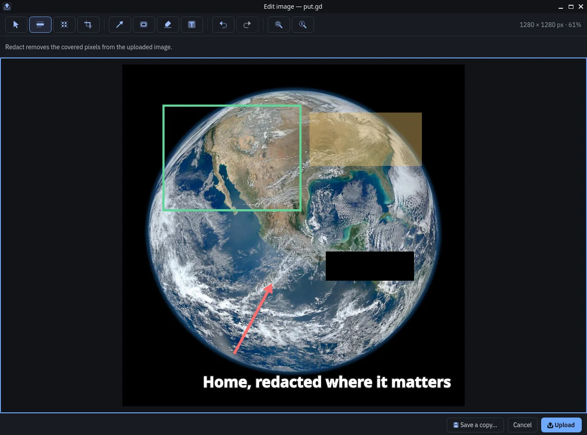

# Edit before uploading

By the end of this page you will have hidden private details, added marks to an image and uploaded only the finished result.

<picture class="shot">
  <source media="(prefers-color-scheme: light)" type="image/avif" sizes="(max-width: 760px) calc(100vw - 32px), 720px" srcset="/_site/shots/edit-light.avif 1609w, /_site/shots/edit-light@2x.avif 3218w">
  <source type="image/avif" sizes="(max-width: 760px) calc(100vw - 32px), 720px" srcset="/_site/shots/edit-dark.avif 1609w, /_site/shots/edit-dark@2x.avif 3218w">
  <source media="(prefers-color-scheme: light)" type="image/webp" sizes="(max-width: 760px) calc(100vw - 32px), 720px" srcset="/_site/shots/edit-light.webp 1609w, /_site/shots/edit-light@2x.webp 3218w">
  
</picture>

1. Choose **Capture region & edit** on the left rail of the put.gd window or in the tray menu. It has no key until you set one in [shortcuts](settings.md#shortcuts).
2. Drag across the area you want to edit. To cancel, press ++esc++.
3. Make your changes in the editor.
4. Choose **Upload**, or press ++ctrl+enter++.

## Edit an image you already have

- **From the tray.** Choose **Edit image**, then **Edit clipboard image** or **Edit an image file…**.
- **From the rail.** Right-click **Capture region & edit** for the same two choices, or drop a PNG or JPEG file on the button.
- **From History.** Select an item and choose **Edit…**, or open its **⋯** menu and choose **Edit image…**. This needs **Keep a local copy** to have been on when you captured it. The result is a new item, and the original stays as it was.

## Tools

| Tool | Key | What it does |
| --- | --- | --- |
| **Redact** | ++x++ | Covers an area with solid black and removes those pixels from the image |
| **Blur** | ++b++ | Blurs an area, with a slider for strength |
| **Crop** | ++c++ | Keeps the area you drag. Choose **Apply crop** or press ++enter++; ++esc++ cancels |
| **Arrow** | ++a++ | Draws an arrow |
| **Rectangle** | ++r++ | Draws an outlined box |
| **Highlight** | ++h++ | Adds a see-through colored marker |
| **Text** | ++t++ | Adds one line of text |
| **Select** | ++v++ | Moves or resizes a mark. ++delete++ removes it |

!!! warning "Blur is not private"
    Blur only changes how the image looks, and it can leave enough detail to guess the text.
    Use **Redact** for passwords, tokens, names and anything else private. Redact changes only
    this edited image, so your original file and any earlier uploads stay as they were.

To undo, press ++ctrl+z++. To redo, press ++ctrl+shift+z++ or ++ctrl+y++.

To zoom, press ++ctrl+1++ for 100%, which is the best way to check the edges of a redaction. Press ++ctrl+0++ to fit the window, or hold ++ctrl++ and scroll.

## Finish your edit

{ .shot }

- **Upload** (++ctrl+enter++) sends only the edited image to the destination shown at the bottom of the window. Your link, local copy and [History](history.md) entry work as they do for any [capture](capture.md). Pressing ++enter++ alone never uploads.
- **Save a copy…** (++ctrl+s++) writes the same edited PNG to a file you choose.
- **Cancel** closes the editor. Once you have made changes, the button reads **Discard…** and asks you first. Nothing is saved or uploaded.

If you quit put.gd during an edit, History lists the edit as interrupted. It never uploads by itself.

## Limits

- Images above 24 megapixels are refused.
- The finished image is always a PNG.
