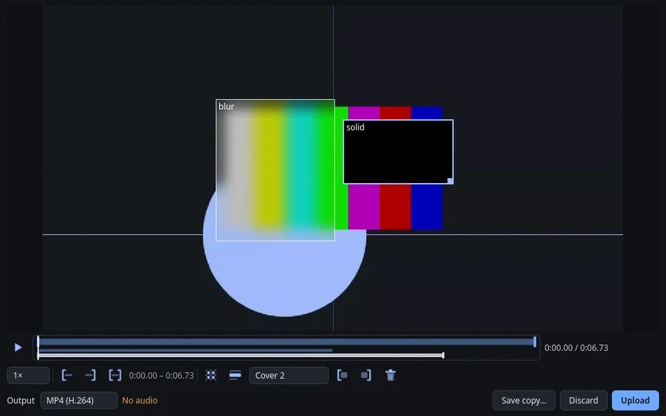

# Record the screen

Record part of your screen, tidy up the clip, then choose what happens to it. Nothing is saved or uploaded until you choose.

<picture class="shot">
  <source media="(prefers-color-scheme: light)" type="image/avif" sizes="(max-width: 760px) calc(100vw - 32px), 720px" srcset="/_site/shots/record-light.avif 920w, /_site/shots/record-light@2x.avif 1840w">
  <source type="image/avif" sizes="(max-width: 760px) calc(100vw - 32px), 720px" srcset="/_site/shots/record-dark.avif 920w, /_site/shots/record-dark@2x.avif 1840w">
  <source media="(prefers-color-scheme: light)" type="image/webp" sizes="(max-width: 760px) calc(100vw - 32px), 720px" srcset="/_site/shots/record-light.webp 920w, /_site/shots/record-light@2x.webp 1840w">
  
</picture>

1. Choose **Record screen** on the rail or **Capture Screen Recording** in the tray. You can also assign a key to **Record screen** in [**Settings → Shortcuts**](settings.md#shortcuts); it has none by default.
2. Drag the area to record. ++esc++ cancels.
3. On the floating bar, choose a format and, if you want sound, tick **System audio**.
4. Click **Start recording**.
5. Click **Stop recording**. The review window opens.
6. Trim or cover what you need, then click **Upload**, **Save a copy…** or **Discard…**.

## Choosing the area

On X11, KDE Plasma and GNOME you drag the area. GNOME needs the put.gd Shell extension for this; see [GNOME](desktops.md#gnome). Other Wayland desktops show their own prompt asking which screen or window to share, usually only the first time.

## The floating bar

Format and audio lock once recording begins.

| Format | Good for |
| --- | --- |
| **Compatible video — MP4 (H.264)** | Sharing links. This is the default. |
| **Smaller video — MP4 (H.265)** | Smaller files, but Firefox and Chrome on Linux can't play these links. |
| **Browser video — WebM (VP9)** | Browsers, except older Safari. |
| **Animated GIF** | Short silent clips, up to 60 seconds and 1280 pixels. |
| **Animated WebP — silent** | The same limits as GIF. |

**System audio** records the sound your computer plays. The microphone is not recorded.

While recording, use **Pause** and **Resume**, then **Stop recording**. Your shortcut also starts and stops the recording. **Cancel** or **Discard…** throws the clip away.

If the bar has no room outside the recorded area, it shrinks to a small handle in the corner that can appear in the clip.

## The review window

Stopping always opens this private review.

- **Play it back** with the play button or ++space++. The preview is silent; audio stays in the file.
- **Trim** by dragging the handles on the timeline, or use **Start here** and **End here** at the playhead. **Reset** keeps the whole clip.
- **Cover something** with **Add mask**: choose **Add redaction** for a solid cover or **Add blur**, then drag on the picture. Drag the ends of its bar on the timeline to set when it shows.

!!! warning "Blur can sometimes be undone"
    Use a solid cover, not blur, for passwords, names and anything else private.

{ .shot }

When you are done:

- **Upload** closes the window and uploads in the background. The result appears in [History](history.md).
- **Save a copy…** writes a file and keeps the window open, so you can still upload.
- **Discard…** asks first, then deletes the recording and your edits. Copies you saved stay.

## If recording will not start

Recording needs an H.264 encoder. When none works, put.gd tells you what to install instead of starting.

=== "Ubuntu, Kubuntu, Mint and Debian"

    The packages bring an encoder with them. There is nothing to install.

=== "Fedora"

    Fedora installs a placeholder library. Replace it with Cisco's:

    ```bash
    sudo dnf install openh264 gstreamer1-plugin-openh264
    ```

    If the `fedora-cisco-openh264` repository was turned off, run this first:

    ```bash
    sudo dnf config-manager setopt fedora-cisco-openh264.enabled=1
    ```

=== "AppImage"

    It carries its own recorder and needs no setup.
