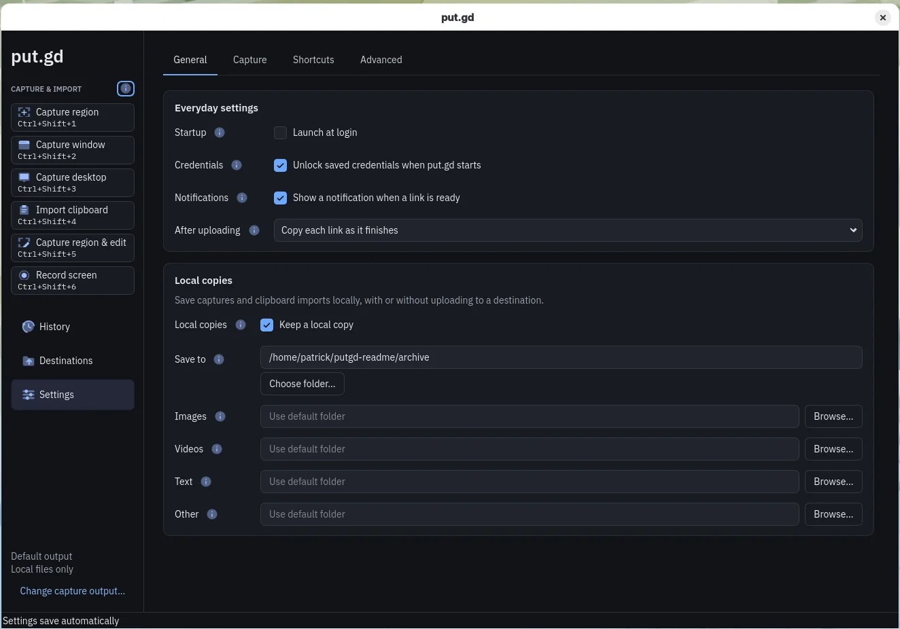
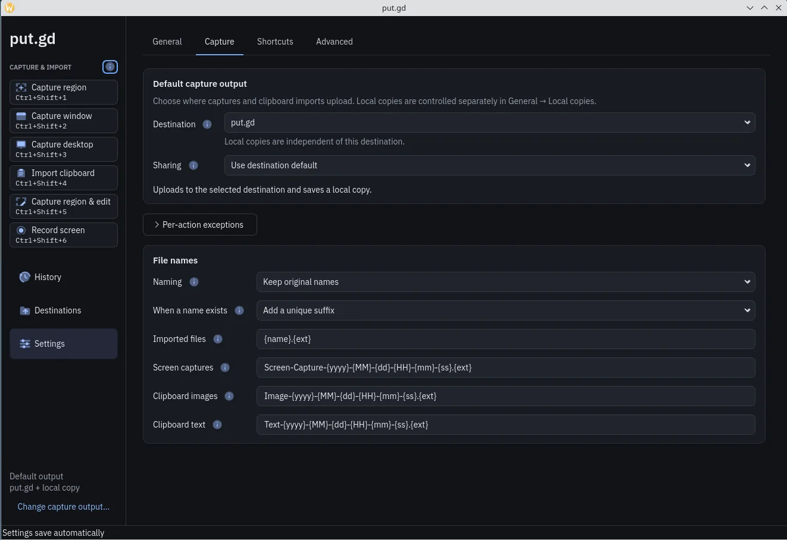
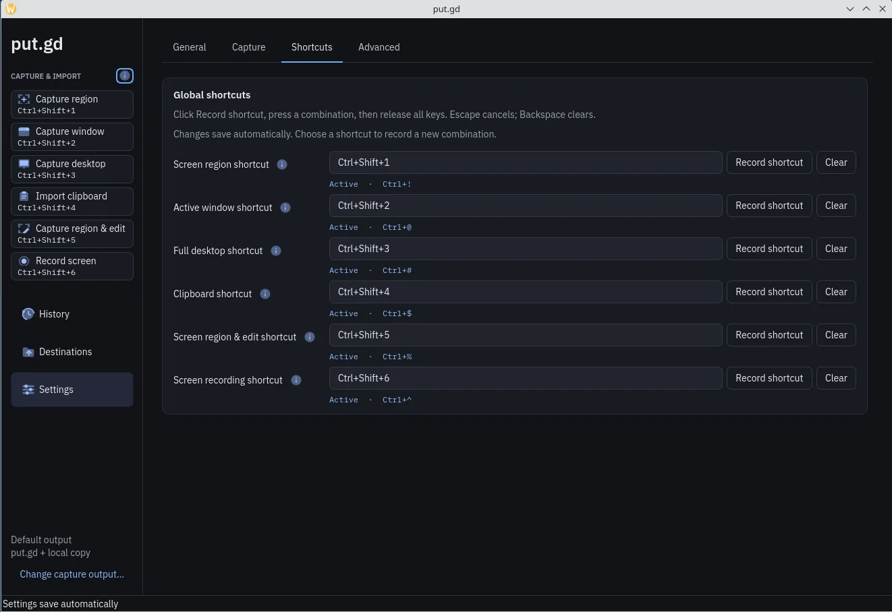

# Settings

Change how put.gd behaves, from where captures go to which keys start them. Each page below matches a page in the app.

<picture class="shot">
  <source media="(prefers-color-scheme: light)" type="image/avif" sizes="(max-width: 760px) calc(100vw - 32px), 720px" srcset="/_site/shots/settings-light.avif 1368w, /_site/shots/settings-light@2x.avif 2736w">
  <source type="image/avif" sizes="(max-width: 760px) calc(100vw - 32px), 720px" srcset="/_site/shots/settings-dark.avif 1368w, /_site/shots/settings-dark@2x.avif 2736w">
  <source media="(prefers-color-scheme: light)" type="image/webp" sizes="(max-width: 760px) calc(100vw - 32px), 720px" srcset="/_site/shots/settings-light.webp 1368w, /_site/shots/settings-light@2x.webp 2736w">
  
</picture>

1. From the tray menu, choose **Settings**.
2. Pick **General**, **Capture**, **Shortcuts** or **Advanced**.
3. Make your change. It saves by itself.

The other pictures here are from an earlier version, so some rows have since moved. The text matches the current app.

## How settings save

Each finished change saves automatically. If a field is invalid, it says why while your other settings stay active.

If saving fails, your changes stay in the window and **Retry saving** appears. put.gd doesn't try again until you click it.

## General

{ .shot }

- **Launch at login** is off by default.
- **Unlock saved credentials when put.gd starts** is on by default. See [unlocking saved credentials](destinations-s3.md#unlocking-saved-credentials).
- **Show desktop notifications** is on by default.
- **Theme** is **Match the desktop**, **Dark** or **Light**, and changes at once.
- **Updates** is covered in [Keeping it updated](updating.md).

## Capture

{ .shot }

- **Destination** is your [default destination](destinations.md#choose-the-default-destination), or **No destination**.
- **Sharing** is **Destination default**, **Create a share link** or **Keep private**.
- **After uploading** is **Copy each link as it finishes** or **Copy a list when uploads finish**.
- **Different output for some actions** holds your per-action exceptions. Click **Add an exception…**.
- **Region selection** sets **While selecting**: **Live desktop** (the default), or **Screenshot first** to freeze the screen so open menus are included. Recording always uses the live desktop.
- **Local copies** has **Keep a local copy**, off by default, which saves files to the **Save to** folder, normally `put.gd` in Documents.

Under **File names**, **Naming** is **Keep original names**, **Random names** or **Custom template**. Templates can use `{name}`, `{ext}`, `{yyyy}`, `{MM}`, `{dd}`, `{HH}`, `{mm}`, `{ss}` and `{uuid}`. **When a name exists** applies to uploads; local files always get a suffix.

## Shortcuts

{ .shot }

1. Click the field next to an action.
2. Press the key combination.
3. Release all keys.

++esc++ cancels. The **×** in the field clears the shortcut.

A row with no status line works as you set it. Otherwise it reports the problem, such as **Conflict** or **Unsupported shortcut**. Your desktop has the final say, so choose another combination.

Capture shortcuts also work while a menu is open, in put.gd or another app. On X11 desktops such as Cinnamon, **Capture region** starts once the menu closes: press ++esc++ or click outside it within 3 seconds.

## Advanced

- Limits cover upload sizes, images, the clipboard and memory. **Reset resource and history limits…** restores them and nothing else.
- **Thumbnail cache** defaults to 256 MB. Set 0 to keep no thumbnails.
- **Keep history for** defaults to **Forever**.
- **Diagnostics** holds debug logging, **Clear logs…** and the diagnostics package, all kept on this computer.
- **Configuration file** shows the file's path. **Reload from file…** replaces this window's settings with the file and asks first if that discards edits.
