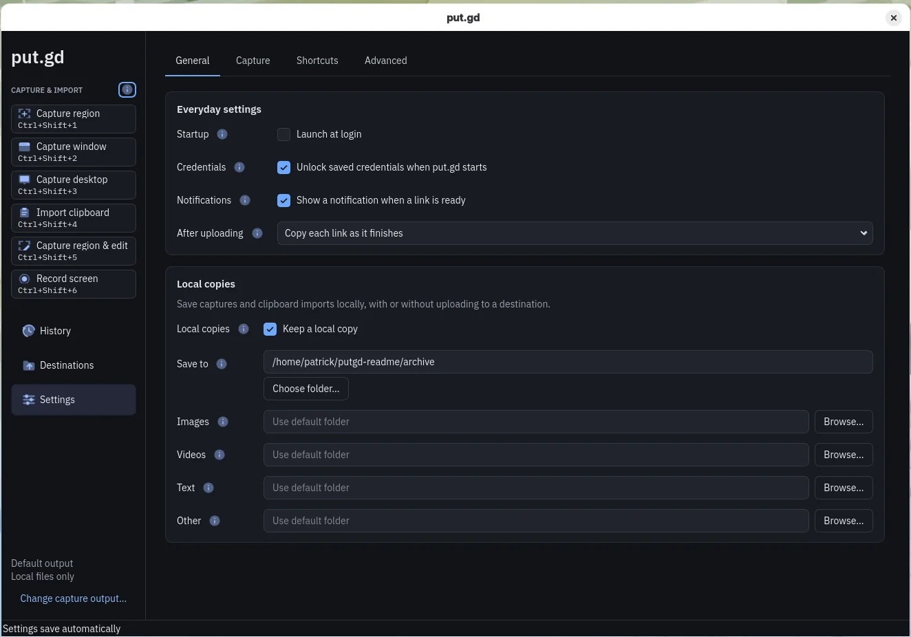

# Keeping it updated

put.gd checks once a day and tells you when a new version is out, but nothing installs without you. By the end of this page, you can install an update and change channel.

{ .shot }

## Check for an update

1. Open **Settings → General → Updates**.
2. Click **Check now**.

The section shows the last result and when the next check runs. To stop the daily check, turn off **Check for updates once a day**.

The check sends one request to app.put.gd with nothing that identifies you, and your computer does the comparison.

## Who is told

When a new version is out, the main window also shows **Update available** under the version. Click it to open the Updates section.

| Your install | Notification | Tray menu |
| --- | --- | --- |
| DEB or RPM | Never: your system's updater tells you | While the repository has a newer version |
| Stable AppImage | Once per version | **Update available** |
| Nightly AppImage | Never | No |

## Update a DEB or RPM

The packages add put.gd's repository, so updates arrive through apt or dnf like any other package.

1. In **Settings → General → Updates**, click **Open software updates**. This opens Update Manager on Cinnamon, Discover on Plasma or GNOME Software on GNOME.
2. Install the update there.

Or use a terminal: `sudo apt update && sudo apt upgrade` on Ubuntu, Mint and Debian, or `sudo dnf upgrade --refresh` on Fedora.

On GNOME, log out and back in after updating. Until then, screenshots keep working but recording a region is refused.

## Update the AppImage

1. In **Settings → General → Updates**, click **Download and install**.
2. Click **Restart put.gd**.

put.gd checks the download against the release's signed checksums and replaces your AppImage, keeping its name. It refuses, and says why, during a recording or upload, or if the folder isn't writable or has too little room.

### If the new version won't start

The old version stays beside the AppImage as a hidden file until the new one has started once.

1. If any of put.gd is still running, choose **Quit** in the tray menu.
2. In a terminal, go to the AppImage's folder: `~/.local/bin` if you used the one-line installer.
3. Find the backup:

    ```bash
    ls -a .putgd-update-backup-*.AppImage
    ```

4. Move it over your AppImage, using `mv` and not `cp`, with the names from your folder:

    ```bash
    mv .putgd-update-backup-VERSION.AppImage putgd.AppImage
    ```

5. Start put.gd as usual. It runs the old version and offers the update again.

## Switch between nightly and stable

There is no stable release yet, so stay on nightly for now.

=== "AppImage"

    1. In **Settings → General → Updates**, choose the other **Channel**.
    2. Click **Switch to** and the version. If that version is older, put.gd asks first, because it may not open settings or history saved by a newer one.
    3. Click **Restart put.gd**.

    Until the first stable release, choosing **Stable** shows no button, and your nightly gets no updates while it's chosen.

=== "DEB or RPM"

    Your system's repository sets the channel, so you move it in a terminal.

    1. In **Settings → General → Updates**, find **Other channel** and click **Copy**.
    2. Paste the commands into a terminal and run them.

    Stable is usually older than the latest nightly. If you leave out the last command, your updater keeps your current version until a newer stable release is out.
